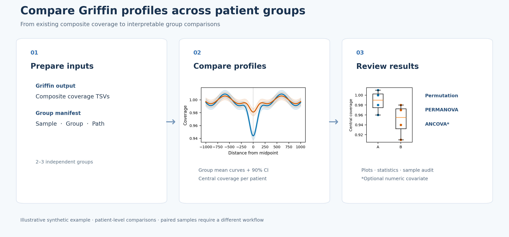

# Griffin Group Comparison

Compare existing Griffin composite coverage profiles between **two or three independent sample groups**. Generate an NDR-centered coverage plot, central coverage boxplot, and exploratory statistical results without rerunning Griffin or reading CRAM files.



## Input

Prepare a tab-separated manifest with `sample`, `group`, and `path` columns. Each row must represent one independent patient or sample. `path` can be a sample output directory or the exact Griffin `*.GC_corrected.coverage.tsv` file. See [example_manifest.tsv](example_manifest.tsv). At least two samples per group are required.

```text
sample       group   path                           ichor_TF  FRAGLE_TF
patient_01   Low     /data/griffin/patient_01       0.02      0.03
patient_02   Low     /data/griffin/patient_02       0.04      0.05
patient_03   High    /data/griffin/patient_03       0.10      0.12
patient_04   High    /data/griffin/patient_04       0.14      0.15
```

Use actual tab characters in the manifest. Check that all samples use the same genome build, region set, Griffin settings, normalization and clinically appropriate sampling time; these properties are not automatically guaranteed by the coverage TSV. If the specified directory contains an `ALL` folder, that subset is selected by default. Multiple matching files cause an error instead of an arbitrary selection.

## Install and run

```bash
python3 -m pip install -r requirements.txt
python3 compare_griffin.py --manifest groups.tsv --output results/new_comparison
```

Optional numeric covariates are fitted in **separate** models:

```bash
python3 compare_griffin.py \
  --manifest groups.tsv \
  --output results/new_comparison \
  --subset ALL \
  --covariate ichor_TF \
  --covariate FRAGLE_TF
```

Run `python3 compare_griffin.py --help` for all options. Use consistent TF units (fractions or percentages). The output directory must be new or empty.

## Methods

- **Input:** supplied composite coverage values are used as-is; no additional smoothing or normalization.
- **Plot:** group mean profiles with pointwise 90% t confidence intervals and patient-level central coverage boxplots.
- **Central coverage:** mean of available positions from −30 to +30 bp, inclusive, by default.
- **Permutation ANOVA:** global comparison of patient-level central coverage using random patient-label permutations.
- **PERMANOVA:** global comparison of full plotted coverage curves using Euclidean distances and patient-label permutations. This tests curves, not the single central coverage value.
- **Optional ANCOVA:** central coverage ~ group + one continuous covariate; an omnibus nested-model F test. Each requested covariate is assessed separately.

Default: 9,999 random permutations with a plus-one correction and seed 42. PERMDISP, paired tests, and multiple-testing corrections are **not** performed. ANCOVA assumes a linear relationship and common slope; assess assumptions and group covariate overlap. Adjustment for the same TF used to define groups can be difficult to interpret.

## Outputs

- `griffin_group_comparison.png` and `.pdf`
- `patients.tsv`, `group_summary.tsv`, `coverage_curves.tsv`
- `tests.tsv`, `input_audit.tsv`, `analysis_metadata.json`

Input paths and sample IDs may be sensitive: keep output audit files private when appropriate. This software compares independent samples only; longitudinal or paired designs require a different statistical workflow. P-values are unadjusted and exploratory unless the study design specifies otherwise.

## References

- Doebley et al., *A framework for clinical cancer subtyping from nucleosome profiling of cell-free DNA*, Nature Communications (2022), [10.1038/s41467-022-35076-w](https://doi.org/10.1038/s41467-022-35076-w).
- This comparison tool is an independent downstream analysis, not the Griffin software or a verified reproduction of every analysis in the paper.

No license has been selected. Before public release, confirm code ownership, dependencies and the desired license. No patient data or reference files are included.
